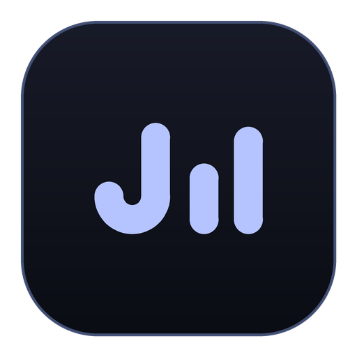

  
  <h1>JustMusic</h1>
  
<b>A sleek, lightweight, and modern Android music player crafted for seamless listening.</b>

  
Ad-Free · Offline Caching · Synchronized Lyrics · Dynamic Audio FX · Open Source

  

    
    
    
    
    
  

  

    
  

  

    
    
    
    
  

---

## ✨ Features Overview

| Feature | Description |
| :--- | :--- |
| 🎵 **Unlimited Streaming** | Instant access to millions of songs, albums, artists, and playlists powered by YouTube Music. |
| 📝 **Synced Lyrics** | Real-time syllable & line-by-line synchronized lyrics powered by LRCLIB, SimpMusic, & Musixmatch. |
| 🎚️ **Pro Audio Lab** | Native 10-band equalizer, AutoEq headphone calibration presets, volume normalization, and pitch shifter. |
| 📥 **Offline Downloads** | Download and cache tracks seamlessly for smooth offline listening without network connection. |
| 🔄 **Multi-Platform Import** | Easily import and sync your playlists from Spotify, Apple Music, and YouTube Music. |
| 🎨 **Dynamic Material UI** | Dynamic Material You theme, custom app icons, fluid gestures, bedside player mode, and blur effects. |
| 🛡️ **Zero Tracking** | No advertisements, no telemetry, and zero data collection. Enjoy pure music with complete privacy. |

---

## 🚀 Getting Started

### Installation Guide

1. Head over to the [**Releases Page**](https://github.com/ZarOffc11/JustMusic/releases/latest).
2. Download the latest **`JustMusic.apk`**.
3. Open the file on your device and tap **Install** *(Enable "Install unknown apps" in Android Settings if prompted)*.
4. Launch **JustMusic** and enjoy!

---

## 🔌 Integrations

- **YouTube Music:** Synchronize your account library, liked songs, and curated mixes without requiring root.
- **Spotify & Apple Music:** Seamlessly migrate playlists with the built-in library importer.
- **Scrobbler:** Real-time scrobbling support for **Last.fm** and **Libre.fm**.
- **Discord:** Real-time Rich Presence showing current playback with live status.

---

## 📈 Star History

  

---

## 🤝 Credits & Acknowledgements

**JustMusic** is developed and maintained by **ZarOfficial** ([@ZarOffc11](https://github.com/ZarOffc11)).

Special gratitude to the open-source projects that made this possible:

- **[Mochy Music](https://github.com/realidkroo/Mochy-Music)** by [realidkroo](https://github.com/realidkroo) — Base project and original UI foundation.
- **[ViviMusic](https://github.com/vivizzz007/vivi-music)** by [vivizzz007](https://github.com/vivizzz007) — Foundation of the core player architecture.
- **[Metrolist](https://github.com/mostafaalagamy/Metrolist)** by [Mostafa Alagamy](https://github.com/mostafaalagamy) — Framework inspiration and utilities.
- **[RiMusic](https://github.com/fast4x/RiMusic)** by [fast4x](https://github.com/fast4x) — InnerTube service integration.
- **[LRCLIB](https://lrclib.net/)** by [tranxuanthang](https://github.com/tranxuanthang) — Synchronized lyrics provider.
- **[AutoEq](https://autoeq.app/)** by Jaakko Pasanen — Headphone equalizer database.

---

## 📄 License

This project is open-source under the **[GNU General Public License v3.0 (GPL-3.0)](LICENSE)**.
